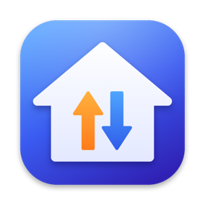
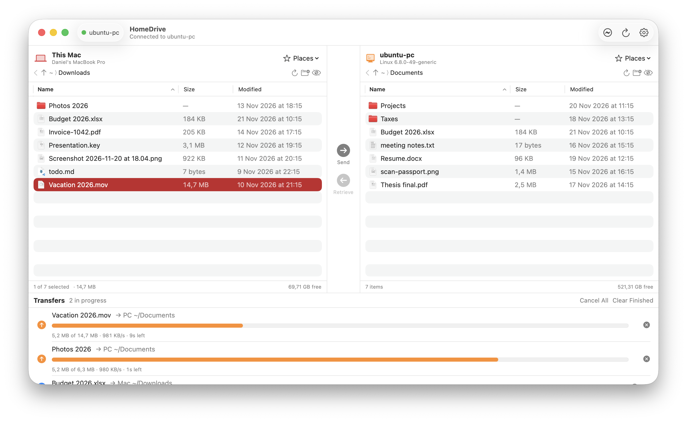
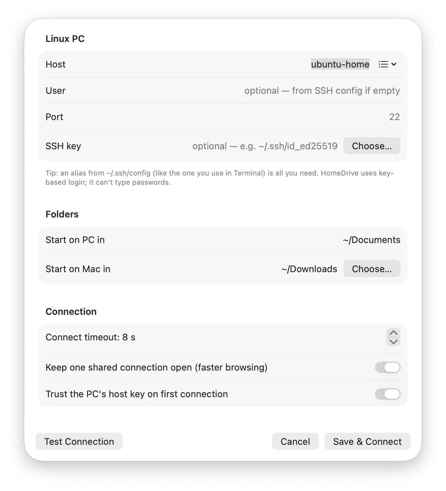

<p align="center">
  
</p>

<h1 align="center">HomeDrive</h1>

<p align="center">
  Your own little iCloud Drive: a native macOS app for moving files between your Mac and your Linux PC over SSH.<br>
  You don't have to open a terminal.
</p>

<p align="center">
  <a href="LICENSE"></a>
</p>

<picture>
  <source media="(prefers-color-scheme: dark)" srcset="docs/images/screenshot-dark.png">
  
</picture>

- **Two panes.** Your Mac on the left, the Linux PC on the right. Browse either one like Finder.
- **Send ➡ / ⬅ Retrieve.** Select files and press a button (or ⌘→ / ⌘←), or drag them:
  - from Finder or the Mac pane onto the PC pane to **upload**
  - from the PC pane onto the Mac pane to **download**
- **Folders work too.** Whole folder trees go across with permissions and dates kept.
- **Places menu.** Jump to Home, Desktop, Documents, Downloads, Pictures, … on either machine. On the PC this follows your desktop's XDG folders.
- **Transfer queue.** Progress, speed and time left for each item. Cancel any transfer. Two run at a time.
- **Safe copies.** Items land in a hidden staging folder and are moved into place only when complete, so a cancelled or failed copy never leaves a half-written file behind. HomeDrive asks before replacing anything.
- **Open PC files directly.** Double-click a file on the PC and it downloads to a cache and opens in its Mac app.
- **Manage PC files.** New folder, rename, delete (to the Linux Trash when available), copy path.
- **Nothing to install on the PC.** It only uses `ssh`, `sh`, `find` and `tar`, which every Linux system already has.

## Requirements

- macOS 14 (Sonoma) or newer.
- Swift 6 toolchain to build: Xcode **or** just the Command Line Tools (`xcode-select --install`).
- A Linux PC you can already reach with **key-based** SSH, e.g. `ssh ubuntu-home` works in Terminal without asking for a password.

> HomeDrive can't type passwords or key passphrases. If your key has a passphrase, add it to the macOS keychain once:
> `ssh-add --apple-use-keychain ~/.ssh/id_ed25519`

## Install

```sh
git clone https://github.com/Daniel3886/homedrive.git
cd homedrive
./scripts/build-app.sh --install     # builds and copies HomeDrive.app to /Applications
```

Leave out `--install` to just build `dist/HomeDrive.app`. To run straight from source while hacking on it: `swift run HomeDrive`.

The app is ad-hoc signed, not notarized. If macOS blocks the first launch, right-click the app → **Open**.

## First run

1. Turn on **WireGuard** (or be on the same network as the PC).
2. Open HomeDrive. The setup sheet lists the hosts in your `~/.ssh/config`; pick yours (e.g. `ubuntu-home`).
   You can also type a plain address like `10.77.0.1` or `yourname.duckdns.org` together with a user name.
3. Click **Test Connection**, then **Save & Connect**.

The first time you open Desktop, Documents or Downloads on the Mac side, macOS asks for permission. Click **Allow**.

### Recommended `~/.ssh/config`

```sshconfig
# Via WireGuard (fast, private)
Host ubuntu-home
    HostName 10.77.0.1
    User your-linux-user
    IdentityFile ~/.ssh/id_ed25519
    IdentitiesOnly yes

# Optional: straight over the internet via DuckDNS (needs port 22 forwarded)
Host ubuntu-duck
    HostName yourname.duckdns.org
    User your-linux-user
    IdentityFile ~/.ssh/id_ed25519
```

## Using it

| To… | Do this |
|---|---|
| Send Mac → PC | Select on the left, click **Send** (⌘→), or drag onto the right pane |
| Retrieve PC → Mac | Select on the right, click **Retrieve** (⌘←), or drag onto the left pane |
| Retrieve somewhere else | Right-click → **Retrieve to…** |
| Open a PC file on the Mac | Double-click it |
| Go to Documents, Desktop, … | **Places** menu at the top of each pane |
| Show dotfiles | 👁 button, or ⇧⌘. |
| Refresh | ⌘R |
| Connect / disconnect | Toolbar button, or ⇧⌘K |
| Rename / new folder / delete | Right-click, or the toolbar of each pane; ⌘⌫ deletes |

Files always go into the folder currently open on the other side, so navigate there first.

## Settings (⌘,)

<picture>
  <source media="(prefers-color-scheme: dark)" srcset="docs/images/settings-dark.png">
  
</picture>

| Setting | Meaning |
|---|---|
| Host | `~/.ssh/config` alias, hostname or IP |
| User / Port / SSH key | Optional; leave empty to use your SSH config |
| Start on PC / Mac in | Folder each pane opens at launch (default: PC home, Mac Downloads) |
| Connect timeout | How long to wait before saying the PC is unreachable |
| Keep one shared connection open | Reuses one SSH connection (`ControlMaster`) so browsing is instant. On by default |
| Trust the PC's host key on first connection | `StrictHostKeyChecking=accept-new`: unknown hosts are remembered; a **changed** key is still refused |

## Troubleshooting

| Message | Fix |
|---|---|
| *Is WireGuard connected and the PC turned on?* | Turn on the VPN; check the PC is awake (`ping 10.77.0.1`) |
| *The host name couldn't be resolved* | Typo in the host, or DuckDNS isn't updating |
| *SSH isn't accepting connections* | On the PC: `sudo systemctl status ssh` |
| *SSH key login was rejected* | Make `ssh <host>` work in Terminal without a password first; see the passphrase note above |
| *Host key doesn't match* | The PC was reinstalled or its IP points to a different machine. Check, then `ssh-keygen -R <host>` |
| *Move to Trash* fails on the PC | Use **Delete Permanently**; the PC lacks `gio` or a desktop session |

Under the hood every action is a plain `ssh` command. To see exactly what runs, read [docs/ARCHITECTURE.md](docs/ARCHITECTURE.md).

## Development

```sh
./scripts/test.sh          # 57 unit + integration tests (works with Command Line Tools only)
swift run HomeDrive        # run the app from source
./scripts/build-app.sh     # build dist/HomeDrive.app
./scripts/screenshots.sh   # regenerate the icon and screenshots in docs/images
```

See [docs/DEVELOPMENT.md](docs/DEVELOPMENT.md) for the project layout, how the tests fake the PC, and how to try the UI without a PC.

## License

HomeDrive is released under the [MIT License](LICENSE).
